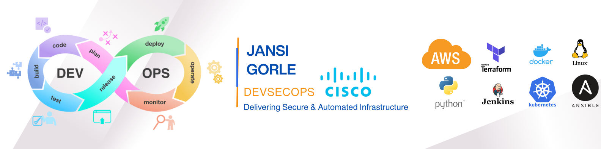
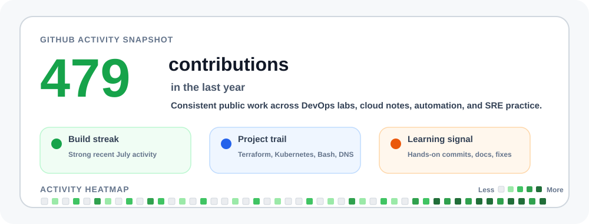

<div align="center">
  

  <h1>Jansi Gorle</h1>
  <h3>DevOps & Site Reliability Engineer</h3>

  <p>
    I build cloud platforms that are automated, observable, secure, and ready for real production pressure.
  </p>

  <p>
    <a href="https://www.linkedin.com/in/gorlejansi/">
      
    </a>
    <a href="mailto:gorlejansi2001@gmail.com">
      
    </a>
    <a href="https://hashnode.com/@jansigorle">
      
    </a>
  </p>

  <p>
    
  </p>
</div>

---

<div align="center">
  
  
  
  
  
</div>

---

## Control Room

<table>
  <tr>
    <td width="58%">
      <h3>Operator Console</h3>
      <pre>
role        = DevOps & Site Reliability Engineer
location    = Hyderabad, India
cloud       = AWS, Azure
platform    = Docker, Kubernetes, Helm, Argo CD
iac         = Terraform, Ansible
pipeline    = Jenkins, GitHub Actions, GitLab CI, Azure DevOps
signal      = Prometheus, Grafana, Splunk, ELK, Zabbix, CloudWatch
language    = Python, Bash, SQL, C++
mindset     = automate toil, reduce risk, improve recovery
      </pre>
    </td>
    <td width="42%">
      <h3>What I Optimize</h3>
      <p><b>Deployment speed</b><br/>CI/CD, container builds, Helm releases, GitOps workflows.</p>
      <p><b>Reliability</b><br/>Monitoring, actionable alerts, incident response, RCA, and runbooks.</p>
      <p><b>Cloud operations</b><br/>Cost control, IAM hardening, scaling, cleanup, and repeatable infrastructure.</p>
    </td>
  </tr>
</table>

---

## Reliability Loop

<div align="center">

| Provision | Ship | Observe | Respond | Improve |
| --- | --- | --- | --- | --- |
| Terraform | Jenkins | Prometheus | P1/P2 triage | Runbooks |
| Ansible | GitHub Actions | Grafana | RCA | Automation |
| AWS | Helm | ELK/Splunk | Rollback | Cost/security fixes |

</div>

```text
Every incident should leave the platform easier to operate than before.
```

---

## Production Engineering Highlights

| Focus | Real Work |
| --- | --- |
| Kubernetes migration | Migrated workloads from ECS to EKS and improved scalability while reducing infrastructure cost |
| Infrastructure as Code | Automated AWS provisioning with Terraform and Ansible across 200+ servers |
| CI/CD acceleration | Built and maintained pipelines for faster, safer releases across microservices |
| Observability | Built dashboards and alerts across Prometheus, Grafana, Zabbix, Splunk, CloudWatch, and ELK |
| Incident ownership | Resolved 500+ P1/P2 incidents and drove RCA documentation for long-term fixes |
| AI for operations | Built case-summary automation using FastAPI, AWS Lambda, ServiceNow, and LLM workflows |

---

## Toolbox

<div align="center">

### Cloud


### Infrastructure and Platform


### Delivery and Quality


### Observability


### Languages and Systems


</div>

---

## Project Signal

<table>
  <tr>
    <td width="50%">
      <h3>CloudOps SRE Platform</h3>
      <p>Hands-on DevOps/SRE learning platform covering cloud operations, Terraform, Kubernetes, monitoring, incident response, and interview-ready labs.</p>
    </td>
    <td width="50%">
      <h3>Roboshop Terraform Platform</h3>
      <p>Multi-stack AWS infrastructure with VPC, security groups, bastion, databases, ALB, Route 53, ACM, launch templates, Auto Scaling, and SSM handoff.</p>
    </td>
  </tr>
  <tr>
    <td width="50%">
      <h3>DevOps Bash Automation</h3>
      <p>Operational scripts for disk checks, backups, logs, service health, cleanup, alerts, and production-readiness checks.</p>
    </td>
    <td width="50%">
      <h3>DNS and Route 53 Labs</h3>
      <p>Structured DNS notes, resolution flow, Route 53 examples, troubleshooting guides, and Terraform-based infrastructure practice.</p>
    </td>
  </tr>
</table>

---

## Certifications

<p>
  
  
</p>

---

## Contribution Signal

<div align="center">
  
</div>

<div align="center">

| Current Signal | What It Shows |
| --- | --- |
| 479 contributions in the last year | Consistent hands-on DevOps learning and project building |
| Strong recent activity | Active repo updates across July with daily build, fix, and documentation work |
| Practical commit trail | Cloud, Terraform, Kubernetes, scripting, DNS, and SRE notes are visible in public work |

</div>

---

<div align="center">
  <h3>Available for DevOps, SRE, Cloud, and Platform Engineering roles</h3>

  <p>
    <a href="https://www.linkedin.com/in/gorlejansi/">
      
    </a>
    
  </p>
</div>
